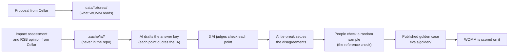

# How WOMM works: start here

This guide is for teammates who did not build the system. It explains what WOMM does, which EU
laws it uses and why, where every answer comes from, and what the human checks are for. The
companion page [checks.md](checks.md) lists every check one by one.

## What WOMM does

WOMM reads a proposed EU law and writes an impact report: **who the law affects, what it makes
them do, and what that costs or brings them**. Several AI "experts" (legal, fiscal, stakeholder)
work on it and a final step writes the report.

To know whether a new version of WOMM is better than the old one, we need a test set with known
good answers. That is what the **golden cases** are.

## Where the right answers come from

When the European Commission proposes a law, it publishes an official **impact assessment (IA)**:
a long report, written by its own experts after public consultation, on exactly the question
WOMM answers. An independent body, the **Regulatory Scrutiny Board (RSB)**, reviews each
assessment before it is published and writes an opinion on it.

So each golden case is: one proposal (what WOMM reads) plus the effects its official impact
assessment names (the answer key). WOMM never sees the impact assessment; it only sees the law.

## The laws we use, and why these

We need many cases: one run of the same WOMM version already moves its score by about 0.1, so a
real improvement only shows across 15-30 cases. The AI Act, which a teammate's data pipeline
provides in full (proposal, final and consolidated text), has one impact assessment, so the
other cases come from other proposals.

The rule for choosing them: **Commission legislative proposals that come with a full impact
assessment**. Omnibus proposals without one were left out. They were downloaded automatically
from the EU Publications Office (EUR-Lex Cellar) by their official numbers; every download is
pinned by checksum. `docs/status/2026-10-04-proposal-imports.md` lists each import.

| Use | Laws |
|---|---|
| Main data for the analysis features, 2 cases | AI Act (from the teammate's pipeline) |
| 11 practice cases | Data Act, Cyber Resilience Act, Digital Services Act, Digital Markets Act, Data Governance Act, General Product Safety Regulation, Batteries Regulation, Platform Work Directive, Product Liability Directive, European Health Data Space, Gigabit Infrastructure Act |
| 8 sealed cases (the "final exam") | newer 2025-2026 proposals, chosen from impact assessments published after June 2025 |
| Background text only, no case | eIDAS revision, Machinery Regulation, Political Advertising Regulation, Interoperable Europe Act |

**What is public and what is sealed.** The text of all 24 laws is in this public repository, so
anyone can work out which 8 laws form the sealed set. What is sealed is their **answer keys**: they
exist only on the owner's machine and in a separate database that only the final comparison reads.
WOMM's self-improvement never sees them, so the final exam stays a fair test.

## How an answer key is made

1. An AI drafts the answer key from the impact assessment. **Every point must quote a sentence
   of the assessment**; a program checks that each quote is really there.
2. Three separate AI judges check every point (is the quote faithful, does it follow from the law,
   is it the right kind of effect). Points all three accept are kept.
3. An AI tie-break settles the points the judges disagreed on: keep or drop.
4. **People check a random sample** of these decisions without seeing what the AI decided
   (the reference check, [checks.md](checks.md)). If the AI was wrong too often, the answer key
   is not used and the prompts are fixed.
5. Only then is the case published and used to score WOMM.

The RSB opinions were added on 2026-10-12: they were downloaded for 15 of the 23 imported laws
(none of the 2025-2026 ones are in Cellar yet). Points they raise are drafted into a separate
"companion" file per case, checked the same way, and merged when the case is published. Most of
an RSB opinion critiques how the assessment was written rather than naming new effects, so few
of its points become answer-key items.

## What happens with your labels

Your answers in the labelling page are saved on the app as you go. The owner downloads them and
compares them, locally, with the AI's decisions you did not see. The result is one number: how
often the AI was wrong. It decides whether the AI-made answer key can be trusted. Your labels do
not edit the cases or the pull requests.

## Glossary

- **Golden case:** one law plus its answer key; WOMM is scored against it.
- **Impact assessment (IA):** the Commission's official report on a proposal's effects.
- **RSB opinion:** the Regulatory Scrutiny Board's review of a draft impact assessment.
- **Practice cases (train/val):** cases WOMM's self-improvement may look at.
- **Sealed cases (holdout):** cases it never sees; used once per comparison, at most 6 times.
- **Judge, tie-break:** AI steps that check and settle the drafted answer key.
- **Grader:** the AI that scores WOMM's report against a golden case; people calibrate it too.
- **Promotion:** adopting a new WOMM version, only if it beats the current one on the sealed cases
  under rules signed before any comparison.
