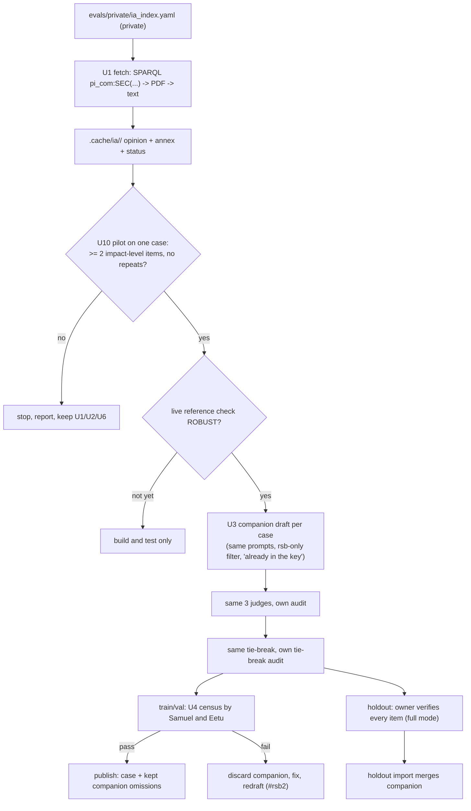

# feat: Real expert sources for the golden cases, and a system the team can read

## Overview

Two problems surfaced on 2026-10-12. First, the golden cases were meant to take their "must
mention" points (important omissions) from the Regulatory Scrutiny Board's (RSB) expert opinion on
each impact assessment (origin R22), but no RSB opinion was ever downloaded: the fetcher looks in
the one Cellar location where opinions are not kept, reports "none found" and silently falls back
to the IA's own procedural annex. Second, at the team meeting the classmates called the system a
black box: they could not tell how the 23 laws were chosen, where the answers come from, or what
their review feeds into, and the owner could not answer either.

This plan fetches the real expert opinions, pilots whether they yield useful must-mention points,
and if they do, adds those points to each case in a separate companion draft that reuses the
existing drafting, judging, tie-break and checking machinery without touching anything the live
human check is sampling. Every new item is checked by people (all train/val items by the
classmates, all holdout items by the owner). It also writes the short guide a newcomer needs, and
the two handoffs the meeting agreed on (the OpenAI key, the console redesign).

---

## Problem Frame

- **The expert layer is missing.** `src/womm/eval/ia_sources.py` `fetch_rsb` only tries
  `.../resource/comnat/SEC_YYYY_NNNN_FIN`. Every one of the 24 IA manifests (the AI Act plus the 23
  imported laws) records "opinion none found in Cellar"; 6 then use the IA's procedural annex as
  "RSB text". Of 37 important omissions in the 11 train/val drafts, 1 is RSB-anchored, and that one
  is anchored in the annex. A working route exists: the Cellar SPARQL endpoint finds the work by
  `cdm:work_id_document "pi_com:SEC(YYYY)N"`, and the work URI serves the opinion as a PDF
  (`Accept: application/pdf`). Verified once, on the Data Act opinion (10 pages, "positive with
  reservations", a list of the IA's shortcomings).
- **The failure was silent.** A missing expert source degraded the answer key without failing
  anything or appearing in any summary the owner reads.
- **RSB opinions mostly critique the draft IA's method.** Many reservations concern baseline,
  option design or evidence, which the published IA then revises. Only the impact-level points an
  agent reading the proposal could be expected to find are useful must-mention items; whether
  enough exist is unknown until a pilot looks.
- **The live human check must not be invalidated.** Samuel and Eetu are labelling a fixed sample of
  40 of the 209 train/val items (sample `2026-10-11-86dae710`). Adding items into an existing draft
  redraws its audit and tie-break samples (`golden_review.integrity_problems` and
  `tiebreak_problems` require each sample to equal a redraw over all eligible ids), flips
  `review.audit` on existing items, and `tiebreak.apply_rulings` refuses a second pass. Almost
  every consumer iterates `GoldenDraft.items()`, so a block inside the draft would touch them all.
- **The reference check does not cover the new item type.** Its 40 items contain almost no
  RSB-sourced item, and the drafting task changes (an output filter and an "already in the key"
  input), so the new items need their own human check, large enough to mean something.
- **The team cannot see the system.** The README is a command reference;
  `docs/status/2026-10-04-proposal-imports.md` is an engineering changelog; the reason for the 23
  laws is one candidate list in `docs/plans/2026-10-04-001-feat-golden-case-expansion-plan.md`.
  At the meeting the review was described inaccurately (as "judge-flagged high-risk items" whose
  answers "feed the PRs via Claude"); the actual design is a blind, stratified random sample,
  scored locally, deciding whether the AI-made answer key can be trusted.
- **What is public.** The fixtures of all 23 laws and the 11 practice-case PRs are public, so which
  8 laws form the sealed holdout can be inferred by elimination already. The sealed asset is the
  holdout answer keys (local and in the separate holdout store), not the law names; the guide must
  say this accurately rather than claim the names are secret.

---

## Requirements Trace

- R1. Fetch the RSB opinion for every fixture whose IA index has an RSB reference, from Cellar, and
  record per fixture whether it was found, from where, and why not when not (origin R22).
- R2. A missing expert source is visible: the fetch script's table and each draft's provenance say
  "found / not in Cellar / unreadable / annex only"; nothing falls back silently.
- R3. Impact-level points the RSB opinion raises become RSB-anchored important omissions, in a
  companion draft per case, without changing any byte of the existing draft; IA-methodology-only
  points are excluded.
- R4. Every new item passes the existing anchor check (verbatim in the opinion), the same three
  judges and the same tie-break, with its own audit and tie-break samples.
- R5. Every new train/val item is labelled by the classmates (a census, blind, hosted); every new
  holdout item is verified by the owner; a failed check discards the companion and allows a
  corrected redraft.
- R6. A newcomer can learn from the repo, in plain words: which laws are used and why, how they
  were fetched, how an answer key is made, what each check does, what happens with their labels,
  and what is and is not secret.
- R7. A classmate can contribute further expert assessments without code and without exposing
  anything through the public repo.
- R8. A classmate can redesign the console against a written contract without backend changes.
- R9. The OpenAI key is handed over, stored, capped and revoked safely, and the provider's data
  terms for holdout text are checked before holdout text is sent.
- R10. Every case that gains items is re-baselined with pooled runs before any comparison uses it.

---

## Scope Boundaries

- No change to existing golden-case items, drafts, digests, audit flags or tie-break rulings.
- No re-draw of the live reference-check sample or of any holdout spot sample.
- No prompt changes to the drafter, judges or tie-break; only their inputs and an output filter.
- RSB and IA identifiers and texts stay out of tracked files; tests use synthetic references and
  synthetic PDF bytes.
- The 4 laws without golden cases stay as corpus; dropping them is an owner choice.

### Deferred to Follow-Up Work

- The console redesign itself: Samuel, against the U8 handoff.
- Drafting from further expert assessments (for example the European Parliament Research Service's
  initial appraisals): gathered through U7, drafted later with the U3 companion mechanism.

---

## Context & Research

### Relevant Code and Patterns

- `src/womm/eval/ia_sources.py`: `fetch_rsb`, `rsb_url`, `cache_ia`, `load_cached_ia`, `CachedIa`,
  manifest `rsb_status`, the procedural-annex fallback.
- `src/womm/data/cellar.py`: `fetch` (content negotiation, disk cache; HTTP 300 raises
  `CellarMultipleChoice`), `fetch_document`; `src/womm/data/ia_index.py` (private index).
- `src/womm/eval/drafting.py`: `DraftInputs` (`notes` is metadata only, never sent to the model),
  `_drafter_input`, `draft_case` (recall step, `_row` anchor check against `rsb_text` for
  `source: rsb`, `run_judges`, auto-accept rule, `draw_audit`, `item_digest`), `GoldenDraft`
  (StrictModel), `MIN_KEPT_IMPACTS` via `golden_review`.
- `src/womm/eval/tiebreak.py`: `needs_tiebreak`, `tiebreak_draft`, `apply_rulings`.
- `src/womm/eval/golden_review.py`: `integrity_problems`, `tiebreak_problems`, `check_draft`,
  `build_case`, `_provenance` (published `provenance` is a closed Literal; the free-text `source`
  field carries the origin).
- `src/womm/eval/reference_check.py`: `population`, `STRATA`, `stratified_sample`, `card` (no
  passage for RSB-anchored items today), `write_sample`; `scripts/reference_check.py`.
- `scripts/publish_golden_cases.py` (train/val), `scripts/verify_golden_case.py` and
  `scripts/holdout_review.py` (holdout decide/spot/full), `scripts/import_holdout_case.py`.
- Drafts: one per `review/case-*` branch (`evals/golden/drafts/`), holdout drafts under
  `.cache/drafts/` of the integration worktree. The review branches do not have the newest code.
- `docs/ui/` (api-contract, design-prompt, schemas, sample run), `scripts/export_ui_contract.py`,
  `web/src/api.ts`, `web/src/types.ts` (hand-written; the contract lacks costs).

### Institutional Learnings

- `docs/solutions/evaluation/single-run-scores-are-noise.md`: coverage moves about 0.1 between
  identical runs, omission scores built from 3-4 items move in steps of 0.25-0.33; pool at least 6
  runs (R10).
- `docs/solutions/llm-backends/jev-question-wording.md`: judge scores depend on question wording;
  no judge prompt changes for the new items.
- `docs/solutions/frontend/manrope-copyright-ligature.md`: a font rule and its e2e check the
  redesign keeps.
- `docs/status/2026-10-04-proposal-imports.md`: Cellar quirks, sha256 pins, and the rule that no
  tracked file names an IA or RSB document.
- The golden-case plan put PDF-only documents out of scope for v1; RSB opinions exist only as PDF
  in Cellar, so that boundary is reversed here, for RSB opinions only.

### External References

- Cellar SPARQL endpoint `https://publications.europa.eu/webapi/rdf/sparql`, property
  `cdm:work_id_document` with values `pi_com:SEC(YYYY)N`; work URIs serve `application/pdf` with
  `Accept-Language: eng`. EUR-Lex pages for the same documents answer automated clients with an
  empty 202 (bot protection), so Cellar is the route.

---

## Key Technical Decisions

- **A companion draft, not a block inside the draft.** Each case gets a second, standalone draft
  file holding only the RSB omissions (`<case>.rsb.yaml` next to the case's draft). It is a normal
  `GoldenDraft` with its own seed (`audit_seed_for(case + "#rsb")`), audit, tie-break audit and
  digests, so drafting, tie-break, `check_draft`, the reference-check population and the holdout
  tools work on it unchanged; only `MIN_KEPT_IMPACTS` is waived for companions. The case's own
  draft stays byte-identical. Publishing and the holdout import merge the companion's kept
  omissions into the case. Rationale: a block inside the draft would change `items()` for every
  consumer and redraw shared samples; re-drafting would replace items under a live human check.
- **Reused models and prompts, a new task, validated by its own check.** The drafter, judges and
  tie-break prompts are unchanged; the task is new (keep only `source: rsb` omissions, an "Already
  in the key" section listing the case's existing claims). Its validity rests on the census check
  (U4), not on the first reference check.
- **Pilot before rollout.** One case (the Data Act opinion, already fetched) is drafted first; its
  yield and the share of impact-level versus methodology points decide whether U5 runs. Threshold:
  at least 2 kept impact-level items and no repeats of existing points, else stop and report.
- **Census, not a sample.** The companions are small (expected a few dozen items in all), so the
  classmates label every train/val companion item, split between them; holdout companion items are
  verified by the owner in full mode. The error rate is a population figure.
- **Opinion and annex kept separately.** `CachedIa` carries the opinion text next to the annex;
  one helper picks the text an RSB anchor is found in, used by the drafter, the judges' context,
  the holdout verifier and the labelling card. Old annex anchors keep verifying; new items must
  quote the opinion.
- **Fail loud.** Fetch status is explicit per fixture; drafts record it; the fetch table lists every
  fixture without an opinion.
- **Honest secrecy.** The guide says the law names are public and inferable; the sealed part is the
  holdout answer keys. Intake for further sources is a private sheet, not a public file.

---

## Open Questions

### Resolved During Planning

- Can the opinions be fetched without scraping EUR-Lex? Yes, SPARQL plus the Cellar work URI.
- Will companions invalidate the live check or any holdout spot sample? No: separate files with
  separate seeds; existing drafts and samples are untouched.
- How large is the check of the new items? All of them (census).
- What if the companion check fails? The companion file is discarded, the input or filter is
  fixed, a new companion version (`#rsb2` seed) is drafted and checked again.

### Deferred to Implementation

- How many of the 23 references resolve in Cellar; whether some PDFs are image-only ("unreadable",
  no OCR here); whether a work answers HTTP 300 with several PDF items (pick the English one).
- Whether 2026 holdout opinions are in Cellar yet.
- The exact companion sizes (the drafter decides; judges and tie-break filter).

---

## High-Level Technical Design

> *This illustrates the intended approach and is directional guidance for review, not
> implementation specification. The implementing agent should treat it as context, not code to
> reproduce.*

---

## Implementation Units

- U1. **Fetch the real RSB opinions**

**Goal:** Every fixture with an RSB reference gets the opinion text from Cellar, or a precise reason
why not.

**Requirements:** R1, R2

**Dependencies:** None

**Files:**
- Modify: `src/womm/eval/ia_sources.py`, `pyproject.toml` (pypdf)
- Create: `scripts/fetch_rsb_opinions.py`
- Test: `tests/eval/test_ia_sources.py`, `tests/test_fetch_rsb_opinions_script.py`

**Approach:**
- Normalise the index reference (`SEC(YYYY) N final` -> `SEC(YYYY)N`), resolve the work by SPARQL,
  accept only work URIs on `publications.europa.eu`, fetch as PDF through the cached
  `cellar.fetch` with a size cap and timeout, extract text with pypdf (page cap). Keep the old
  comnat attempt first; record which route worked, the URL and sha256.
- Cache: the opinion in its own file next to the annex text; `CachedIa` gains the opinion text and
  status; `load_cached_ia` reads both. The script refreshes only the RSB part for every fixture in
  the private index and prints a table (fixture, status, words). Nothing it writes is tracked.

**Patterns to follow:** `cellar.fetch` caching and pinning, `cache_ia` manifest writing,
`scripts/import_proposal.py` private-index handling.

**Test scenarios:** (synthetic references and synthetic PDF bytes only)
- Happy path: one SPARQL binding and a PDF body -> status "found", text contains the findings
  sentence, sha256 recorded.
- Edge case: `SEC(2099) 7 final` and `SEC(2099)7` produce the same query.
- Edge case: no binding -> "not in Cellar"; two works -> the first parseable PDF, both URIs kept;
  HTTP 300 listing -> the English PDF item.
- Error path: a work URI on another host -> refused; a PDF over the size cap -> refused; a PDF
  without a text layer -> "unreadable", annex kept; a network error -> status says so, no partial
  file.
- Integration: refreshing a fixture whose annex anchors an existing omission keeps that anchor
  verifiable.

**Verification:** The table lists all 23 imported fixtures with a precise status; found opinions
start with the RSB title and verdict.

- U2. **Make missing experts visible, and show RSB context**

**Goal:** No draft stands silently without its expert opinion, and labellers see context for RSB
items.

**Requirements:** R2

**Dependencies:** U1

**Files:**
- Modify: `src/womm/eval/drafting.py` (provenance records the opinion status; the RSB-text helper
  used by `_row` and the judges' anchor context), `scripts/draft_golden_case.py`,
  `scripts/verify_golden_case.py` (in-context display), `src/womm/eval/reference_check.py` (`card`
  shows the passage for RSB anchors)
- Test: `tests/eval/test_drafting.py`, `tests/eval/test_reference_check.py`,
  `tests/test_verify_golden_case_script.py`

**Approach:** One helper returns the RSB text an anchor is found in (opinion first, then annex);
every RSB consumer uses it. Drafting summaries print the opinion status.

**Test scenarios:**
- Happy path: a card for an opinion-anchored item has a passage with the quote highlighted.
- Edge case: an annex-anchored item still gets its passage, from the annex.
- Error path: drafting a fixture without an opinion prints "RSB opinion: not in Cellar" in the
  summary and records it in provenance.
- Integration: `verify_golden_case` shows the context of an opinion-anchored item (no "ANCHOR NOT
  FOUND").

**Verification:** Every RSB-anchored item shows context to a labeller; every draft says whether the
opinion was used.

- U10. **Pilot on one case**

**Goal:** Decide on evidence whether RSB opinions yield useful must-mention points.

**Requirements:** R3

**Dependencies:** U1, U2, U3 (code)

**Files:**
- Modify: `docs/plans/2026-10-12-001-feat-expert-sources-and-onboarding-plan.md` (record the result)
- Test expectation: none -- a measured decision, recorded

**Approach:** Draft the companion for the Data Act case locally (not committed). Classify each kept
item as impact-level or methodology, check for repeats of existing claims. Proceed to U5 only if at
least 2 kept items are impact-level and none repeat; otherwise stop and report, keeping U1, U2, U6.

**Verification:** A recorded yield, classification and go/no-go decision.

- U3. **Companion drafts for RSB omissions**

**Goal:** Draft, judge and tie-break RSB omissions in a standalone companion draft per case.

**Requirements:** R3, R4

**Dependencies:** U1, U2

**Files:**
- Modify: `src/womm/eval/drafting.py` (a companion drafting entry point: drafter message with an
  "Already in the key" section, recall skipped, only `source: rsb` omissions kept, judges on those
  only; companion marker in provenance), `src/womm/eval/golden_review.py` (waive
  `MIN_KEPT_IMPACTS` for companions; `build_case` merges a companion's kept omissions with `source`
  "RSB opinion (companion), <section>" and provenance from `_provenance`),
  `scripts/publish_golden_cases.py`, `scripts/import_holdout_case.py` (merge on publish/import),
  `scripts/holdout_review.py` (a companion is reviewed in full mode)
- Create: `scripts/draft_rsb_companion.py`
- Test: `tests/eval/test_rsb_companion.py`, `tests/eval/test_golden_review.py`,
  `tests/test_publish_golden_cases_script.py`

**Approach:** The companion is a `GoldenDraft` whose case id is the case's, marked as a companion,
with omission ids continuing after the case's last omission id. The existing tie-break script runs
on it unchanged. A companion version suffix (`#rsb`, `#rsb2`) seeds its samples; a second
companion for the same version is refused, a new version replaces a discarded one.

**Execution note:** Start with a characterization test that a case's own draft is byte-identical
before and after its companion is drafted, tie-broken and checked.

**Test scenarios:**
- Happy path: a tie-broken case draft plus a synthetic opinion -> a companion with 2 omissions
  anchored in the opinion; the case draft unchanged (characterization).
- Edge case: the drafter returns impacts and IA-sourced omissions -> discarded.
- Edge case: an omission repeating an existing claim -> the judges or tie-break drop it; the
  "Already in the key" section is present in the drafter message.
- Edge case: a fixture without an opinion -> no companion, status recorded.
- Error path: drafting the same companion version twice -> refused; after discarding, `#rsb2`
  drafts.
- Integration: `check_draft` passes the companion with zero impacts; publishing yields the case's
  omissions plus the kept companion omissions with a valid provenance; the case's audit sample is
  unchanged.

**Verification:** Companions pass their own checks; case drafts are untouched; published and
imported cases carry the merged omissions.

- U5. **Run the companions on all 19 cases**

**Goal:** Companions for the 11 train/val and 8 holdout cases.

**Requirements:** R3, R4

**Dependencies:** U3, U10 go; the live reference check (sample `2026-10-11-86dae710`) scored
ROBUST; U1-U3 code merged into the integration branch and from there into each `review/case-*`
branch

**Files:**
- Create: `evals/golden/drafts/<case>.rsb.yaml` on each `review/case-*` branch; holdout
  companions under `.cache/drafts/` (untracked)
- Test: existing `tests/eval/test_golden_drafts.py` on each review branch

**Approach:** Fetch, draft, tie-break, strict gate, commit one companion file per review branch
(the PR diff against its updated base shows only that file). Holdout companions stay local; the
existing holdout spot samples are computed on the case drafts only and do not change.

**Test expectation:** none beyond the existing draft gate -- a data run of U1-U3.

**Verification:** Each review PR adds exactly one companion file; holdout spot samples are
unchanged.

- U4. **People check every new item**

**Goal:** A population-level error rate for companion items, and a way back if it fails.

**Requirements:** R5

**Dependencies:** U5

**Files:**
- Modify: `scripts/reference_check.py` (draw a census from companion drafts: `--companions`),
  `src/womm/eval/reference_check.py` (population over companion drafts; same three strata)
- Test: `tests/eval/test_reference_check.py`

**Approach:** Every train/val companion item, split evenly between Samuel and Eetu, blind, hosted as
a new sample id; scored by the same rules, reported as a population error rate. Holdout companion
items: the owner verifies each one in `holdout_review.py` full mode. Fail (above 10%): discard the
companions, fix the input or filter, redraft as `#rsb2`, check again. Deadline: if not labelled
two weeks before the demo, companion items are left out of promotion comparisons and published
only after the check.

**Test scenarios:**
- Happy path: `--companions` puts every companion item on exactly one annotator's page, cards with
  passages, nothing from the case drafts.
- Edge case: an odd count -> one annotator gets one more.
- Integration: uploading the census leaves the first sample's tasks and answers untouched.

**Verification:** Two verdicts, one per item type; companions published only after theirs passes.

- U6. **The guide: how WOMM works, in plain words**

**Goal:** A classmate understands the system from the repo alone.

**Requirements:** R6

**Dependencies:** None for the first version; facts from U1-U5 added as they land

**Files:**
- Create: `docs/guide/README.md` (the system on one page: the laws and why, a lineage diagram from
  Cellar to published case, what is public and what is sealed, a short glossary), `docs/guide/
  checks.md` (every human and automatic check: what, why, who, when, what happens with the
  result), `docs/solutions/data/cellar-rsb-opinions.md` (the silent fallback and the route, no
  fixture identifiers)
- Modify: `README.md` (link to the guide at the top)
- Test: `tests/test_docs_leaks.py` (docs/guide, docs/solutions, docs/status contain no
  `SEC(YYYY)` or `SWD(YYYY)` identifiers and no Cellar work URIs)

**Approach:** Version 1 by the 2026-10-16 meeting: the two guide pages. Law selection: Commission
proposals with a full IA, omnibus proposals without one excluded, the sealed set chosen from IAs
published after June 2025; the guide says the law names are public and the sealed part is the
answer keys. The review explained correctly: a blind stratified random sample, scored locally,
deciding whether the AI-made key is trusted; labels do not edit PRs.

**Test scenarios:**
- Happy path: the committed docs pass the leak scan.
- Error path: a doc containing `SEC(2099) 7` fails the scan.

**Verification:** A reader who has not seen the code can answer the meeting's three questions.

- U7. **Intake for further expert assessments**

**Goal:** Samuel can gather expert sources without code and without public exposure.

**Requirements:** R7

**Dependencies:** U6

**Files:**
- Create: `docs/guide/contributing-expert-sources.md`
- Test expectation: none -- documentation; the data goes to a private shared sheet

**Approach:** One page: what counts (official, independent assessments of a Commission IA or
proposal: European Parliament Research Service initial appraisals, Council or committee analyses;
RSB opinions are fetched automatically), the columns (law, type, URL, date, language), and that
the sheet is shared privately with the owner, never committed.

**Verification:** Samuel has a one-page task.

- U8. **Console redesign handoff**

**Goal:** Samuel redesigns the console against a complete contract.

**Requirements:** R8

**Dependencies:** None

**Files:**
- Modify: `docs/ui/api-contract.md` (cost section, evolution endpoints), `docs/ui/design-prompt.md`
  (screens, what each shows, constraints), `docs/ui/README.md`, `scripts/export_ui_contract.py`,
  `docs/ui/schema/*`
- Test: `tests/test_export_ui_contract_script.py`

**Approach:** The boundary: `web/src/api.ts`, `web/src/types.ts` and `web/src/model/` stay; screens,
components and design tokens are free. Work against `docs/ui/sample_run.json` and the e2e fake
server; keep the a11y scan and the font-ligature check.

**Test scenarios:**
- Happy path: exported schemas equal the committed ones.
- Edge case: a run with a cost section validates against the contract.

**Verification:** A designer can build every screen from the docs and sample data alone.

- U9. **Key handover and re-baseline**

**Goal:** The key exists and is handled safely; the cases that gained items are re-measured.

**Requirements:** R9, R10

**Dependencies:** U5; a classmate's OpenAI account

**Files:**
- Modify: `docs/guide/checks.md` (the key path), `docs/status/2026-10-07-v1-human-steps.md` (on the
  branch that holds it)
- Test expectation: none -- operational

**Approach:**
- The classmate creates a project with a hard USD 10-20 limit and a project-scoped key, and hands
  it over through a one-time secret link (not chat or email). The owner stores it only in `.env`
  (gitignored), never in logs or run artifacts. The classmate revokes it after the demo.
- Before holdout text is sent to the provider, check the API's retention and no-training terms; if
  they are not acceptable, holdout drafting and holdout comparisons stay on the local backend.
- After publishing, the train/val baseline and the R34 noise run use pooled runs (at least 6); the
  promotion records note the re-baselined cases.

**Verification:** Calibration and the noise run are unblocked; the key's lifecycle and the data
terms are recorded.

---

## System-Wide Impact

- **Interaction graph:** drafting, tie-break, integrity checks, publishing, the holdout import and
  review, the reference-check population and the labelling card read companions or the RSB helper.
- **Unchanged invariants:** every existing draft byte, digest, audit and tie-break sample; the live
  reference-check sample, key and verdict; holdout spot samples; the signed promotion policy.
- **State lifecycle risks:** cache files rewritten per fixture with the annex kept; a discarded
  companion is deleted whole, never edited.
- **API surface parity:** the hosted labelling API is unchanged; the census is a new sample id.
- **Integration coverage:** the characterization of untouched case drafts; publish and import of a
  case with a companion, end to end.

---

## Risks & Dependencies

| Risk | Mitigation |
|------|------------|
| Opinions missing in Cellar or image-only | Status per fixture, listed in the guide; no fallback presented as an opinion |
| Opinions yield mostly methodology points | U10 pilot decides before any rollout |
| The live reference check is not ROBUST | U5 waits; U1-U3 are built and tested meanwhile |
| Companion check fails | Discard whole, fix, redraft `#rsb2` |
| Classmates' time | Census of a few dozen items, split; deadline fallback keeps companions out of comparisons |
| Key leaks or overspends | One-time link, project key, hard cap, `.env` only, revocation after the demo |
| Holdout text sent to the provider | Data terms checked first; local backend otherwise |
| Docs leak identifiers | Leak-scan test over docs |

---

## Documentation / Operational Notes

- 2026-10-16 meeting: walk through `docs/guide/` and correct the 2026-10-12 description of the
  review.
- The human-steps file gains the census and the key path.

---

## Sources & References

- **Origin document:** [docs/brainstorms/2026-09-28-womm-phased-requirements.md](../brainstorms/2026-09-28-womm-phased-requirements.md) (R22, R23, R24, R33, R34)
- Related plan: `docs/plans/2026-10-04-001-feat-golden-case-expansion-plan.md`
- Related code: `src/womm/eval/ia_sources.py`, `src/womm/eval/drafting.py`,
  `src/womm/eval/tiebreak.py`, `src/womm/eval/golden_review.py`, `src/womm/eval/reference_check.py`
- Related PRs: #7-#17 (train/val drafts), #18 (latest branch)
- Meeting: team catch-up 2026-10-12
