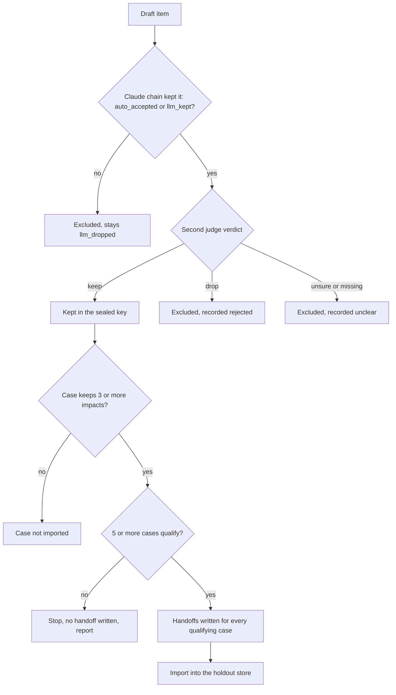
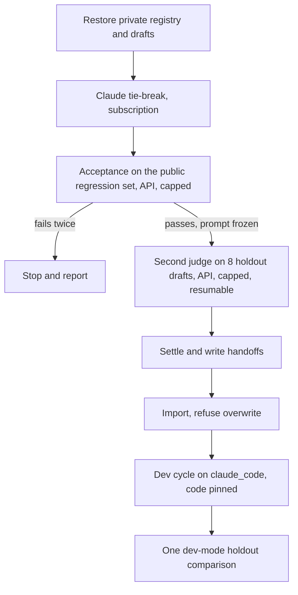

# Holdout Second Judge - Plan

---

## Goal Capsule

- **Objective:** the v1 demo ends in one promotion decision on a sealed holdout of at least 5 proposals, whose answer key no person had to read, and every document that cites the key says how it was settled.
- **Means:** a blind second judge on the OpenAI API, from a different model family than the Claude drafting chain, keeps an item only when both agree (KD1, KD2, KD5); the demo runs the claude_code dev gate (KD3).
- **Authority:** origin requirements R23, R28, R30 > this plan's Product Contract > Key Technical Decisions > units.
- **Stop conditions:**
  - Acceptance (R6) still fails after two prompt revisions: stop before any holdout call and report.
  - Fewer than 5 cases survive the floor (R4): stop before import and report. No rule changes after any holdout verdict is seen.
  - Any command would exceed its USD cap (R7): stop, report spend so far.
- **Execution profile:** docs first (U1), code test-first (U2 to U5), then the operational run (Operational Notes).
- **Who finishes:** the agent implements, opens the PRs and runs the pipeline; the owner merges.

---

## Product Contract

### Summary

The 8 holdout drafts are settled by the existing Claude chain, then judged item by item by `openai:gpt-6.1-sol`, which sees each claim and its source passage but none of the Claude decisions. Only items both kept enter the sealed key. The judge first passes a two-sided acceptance on the public regression set, every paid call runs under a hard USD cap, and the docs on main switch to this route before the code lands.

### Problem Frame

The demo's promotion decision needs a sealed holdout (R23, R28, R30). The runbook planned an owner spot check after a ROBUST reference check, but the reference check failed (2026-10-16), so the owner would have had to review all 131 items of the 8 drafts. The owner wants no human review. The runbook's own reason for keeping a human ("the system under test and the judge run on the same model") is answered by a judge from another model family. The Codex login on this machine is a free personal account whose data may train models, so the judge runs on the OpenAI API key already in `.env`.

### Key Decisions

- KD1. **No person reviews holdout items; a cross-family second judge does.** (session-settled: user-directed — chosen over the owner reviewing all 131 items or only tool-flagged items: the owner wants no human work.) Governs R2, R3, R9.
- KD2. **The second judge runs on the OpenAI API, `openai:gpt-6.1-sol`.** (session-settled: user-directed — chosen over the Codex subscription: the Codex login here is a free personal account whose data may train models; the API needs no login, does not train on API data by default, and its backend already exists.) Governs R2, R7, R8.
- KD3. **The v1 demo runs one claude_code dev-mode holdout comparison, without calibration, R34 or a formal comparison.** (session-settled: user-approved — chosen over the formal api route with a classmate calibration sitting: no classmates and no Railway are needed.) Governs R11.
- KD4. **The holdout stays in v1.** (session-settled: user-directed — chosen over dropping the holdout gate: the v1 success criterion needs a holdout-backed decision.) Governs R1, R5, R11.
- KD6. **The key is re-settled once, with full-text evidence, before any comparison.** (session-settled: user-directed — chosen over sealing the 6-case, 23-impact key of the first run or adding new holdout cases: that key held only points stated near their anchor, and no system had yet been compared on it.) The first key stays backed up and sealed until the full-text judge passes its own acceptance; if it fails, the first key is kept. Governs R5.
- KD5. **Doubt excludes; the floor and the stop rule are fixed now.** (session-settled: user-approved — proposed with the item-loss tradeoff and the per-draft counts; the owner confirmed.) Governs R3, R4.

### Requirements

**Holdout key**

- R1. The 8 holdout drafts are settled by the existing Claude chain (three judges and the tie-break) on this machine.
- R2. A second judge judges every item of every holdout draft, auto-accepted items included, blind to every Claude verdict, reason, ruling, category change and review decision, and answers keep, drop or unsure with a reason.
- R3. An item enters the holdout key only when the Claude chain kept it and the second judge answers keep; every other item is excluded and never shown to a person.
- R4. A case with fewer than 3 kept impacts (`MIN_KEPT_IMPACTS`) is not imported; if fewer than 5 cases remain, the run stops before any import.
- R5. The judge's prompt, model and these rules are frozen before the first holdout call, and a sealed case cannot be silently replaced. The one exception is KD6: a deliberate, recorded re-settlement before any holdout comparison.

**Judge quality**

- R6. Before any holdout call, the judge passes a two-sided acceptance on `evals/regression/key_fidelity_2026-10-17.yaml`: it keeps no unsupported point, and it keeps most supported points (KTD4), so a judge that drops everything fails.

**Cost and data**

- R7. Every paid call runs under a hard USD cap, and work already paid for is never paid again after a crash or a rate limit.
- R8. Holdout text goes only to the OpenAI API. No holdout case id, proposal name or key text reaches git, LangSmith or committed docs; committed records carry aggregates only.

**Provenance**

- R9. The stored key and every document that cites it name the method: kept only where the Claude chain and `gpt-6.1-sol` agree, no human check. Nothing calls it human-verified or spot-checked.
- R10. Kept and excluded counts per reason, and the two families' agreement rate, are recorded privately per case and as totals in the runbook.

**Route and docs**

- R11. The R30 demo runs one dev-mode holdout comparison on claude_code; its decision reads "dev-only, not deployable".
- R12. The runbook, README, guide and demo materials on main describe this route and this wording.

### Acceptance Examples

- AE1. **Covers R3.** Given the Claude chain auto-accepted an item and the second judge answers unsure, the item is excluded, recorded as `unclear` with the judge's reason, and absent from the sealed case.
- AE2. **Covers R3.** Given the tie-break dropped an item and the second judge answers keep, the item stays excluded.
- AE3. **Covers R4.** Given a draft keeps 2 impacts after R3, no handoff is written for it and the run report names it as under the floor.
- AE4. **Covers R2.** The judge's input for any item contains none of: judge verdicts or reasons, the tie-break block, review decisions, category, derivability, flags, `why_missing`, the list of kept items, or the original item id.
- AE5. **Covers R5.** Given a case is sealed, importing a handoff for the same case with a different body is refused and the store is unchanged.

### Success Criteria

- The holdout store reports at least 5 cases, each with at least 3 impacts, settled with zero person-minutes.
- Acceptance plus settlement cost less than USD 5 in total at list price.
- `womm evolve promote` runs one dev-mode comparison on that store.

### Scope Boundaries

- No human review of any holdout item.
- The formal api gate, the calibration sitting and R34 stay in the code, unused for the v1 demo.
- No Railway work, no change to train/val keys, the coverage judge or the evolution cycle.
- No Codex backend (KD2 replaced it).
- Built on 2026-11-03 (KD6), after being considered and first left out: giving the judge full-text retrieval over the whole IA. The full-text key check decided only 39% of clauses (docs/status/2026-10-07-v1-human-steps.md), and under R3 every undecided claim is lost. The cost is that items supported only far from their anchor are excluded. Revisit when U3's printed W keep count on w01 to w11 is read, which happens before any holdout call and never after one.

#### Deferred to Follow-Up Work

- A cross-family re-score of the dev comparison (`womm evolve rescore` uses Claude, the same family as the dev gate).

### Risks

- Gate B's positive controls are labelled supported for one clause each; a judge that rightly drops a point for another, unscreened clause still counts a miss. The 3 allowed misses absorb this; a gate B failure is read case by case before a prompt revision is spent.
- Excluding far-supported items (KTD2) may push cases under the floor; R4's stop rule catches it before import.

### Dependencies / Assumptions

- `OPENAI_API_KEY` in `.env` is valid for `gpt-6.1-sol`; a monthly limit on the key is the owner's setting and is not checked by code.
- The Claude subscription logged in on this machine passes `womm selfcheck` for the tie-break and the dev cycle.
- A local Postgres (docker-compose) hosts the holdout store and the archive database.

### Sources

- Origin: docs/brainstorms/2026-09-28-womm-phased-requirements.md (R23, R28, R30, success criterion v1).
- docs/status/2026-10-07-v1-human-steps.md steps 3 to 7 (reference check NOT ROBUST, holdout step, dev-gate fallback).
- docs/plans/2026-10-16-001-fix-answer-key-fidelity-sweep-plan.md (over-reach rates, the regression set, Codex-ruled labels).
- docs/solutions/evaluation/single-run-scores-are-noise.md.

---

## Planning Contract

### Key Technical Decisions

- KTD1. **The judge is a drafting role on the existing api backend.** `evals/drafting.yaml` gains `second_judge` (backend `api`, model `openai:gpt-6.1-sol`, reasoning effort `medium`, prompt `prompts/tools/second_judge.md`). The `Backend` literal and the backend factories do not change. The role-set pin in tests/eval/test_drafting.py widens to allow `api` for this role only. Instantiates KD2 (R2, R7).
- KTD2. **Blind input from item content only.** Per item: a neutral id (`i01`, …), the claim (actor, mechanism, impact; or the omission's description), the text of each provision it cites (from the scenario's after-version, up to 2500 characters each), and a sentence-expanded passage of about 3000 characters (1500 on each side) around the anchor quote, from the IA or the RSB opinion as `anchor.against` says. Everything AE4 lists is withheld. At most 15 items per call; an item without a verdict counts as unsure. Revision of 2026-11-03 (KD6): after the window, each item also gets up to 4 passages from anywhere in the IA, the board's opinion or the proposal, ranked by BM25 on the point's own fields with no model call (the full-text key check's index, `womm.eval.key_sources`; a board-opinion point searches the opinion and the proposal only). Before it, the passage did not recover the regression set's window misses: none of w01 to w11 has its cited line within 3000 characters of its anchor (the closest is w01 at 3,187), so items supported only far from their anchor are expected to be lost; U3 measures that rate before any holdout call.
- KTD3. **Recording follows `spot_verify`.** A second-judge drop becomes `rejected`, unsure becomes `unclear`, each with the note "second judge (openai:gpt-6.1-sol): <reason>" and reviewer `second-judge:openai:gpt-6.1-sol`. Kept items keep their `llm_judged` or `llm_tiebroken` provenance. `check_draft` gains a `holdout_second_judge` mode, and `review_notes` plus the audit-escalation note gain second-judge wording instead of "Human review by". The handoff's `verified_by` reads `two-family agreement: claude tie-break chain + openai:gpt-6.1-sol` and it carries a `second_judge` record: model, prompt sha256, acceptance record reference, counts.
- KTD4. **Two-sided acceptance, two independent runs.** A run is one full pass over two conditions, and the whole pass is repeated twice.
  - Condition W: all 31 cases on holdout-identical input: the whole point, the anchor passage of KTD2, and the provision keys and provisions block taken from the published case (`evals/golden/<case>.yaml`, the item matched by the case's `point`, its `scenario_id`). The judge never sees `kind`, `why`, `expected` or `source`. j01 to j04 name no case, so they get no provisions block, and the record says so.
  - Condition C (revised 2026-11-03, before any holdout call, owner-approved): the 15 supported cases on their labelled clause (`claim`, shown as `claim_to_judge` with the rest of the point as `context_only`, as the reference-check pages showed it) instead of the whole point, each with the W anchor passage, its provisions and, for a window case, a 3000-character passage around every IA location its `source` cites (both locations for w11). The first run judged the whole point and kept 7 and 6 of 15: the set labels one clause per case, and several supported points carry another clause the source does not support (a likelihood stated as a fact, a number the text does not give), which the judge rightly dropped. Gate A still judges whole points, as the holdout is judged.
  - Gate A, scored on W: no keep on the 15 points that hold a `not_supported` claim.
  - Gate B, on C: at least 12 of the 15 supported clauses kept (l01, l02, j01, j03, w01 to w11).
  - Unsure counts as not kept. A run passes when both gates pass; acceptance needs both runs to pass.
  - The report also gives both gates without the 5 Codex-labelled cases (j01 to j04, w12), and W's keep count on w01 to w11, printed as the expected loss of far-supported holdout items.
  - The full-text judge (KD6) is a new judge version: it passes the same gates afresh, with retrieval in both conditions and no passage taken from a case's `source`, and gets at most 1 prompt revision; if it fails, the first key stays.
  - At most 2 prompt revisions; the passing prompt's sha256 and the aggregates are committed in `evals/regression/second_judge_acceptance.yaml`. Revision 1 (2026-11-03) added one general rule after the first run kept, in both passes, a point claiming operators bear new liability on the strength of the provisions alone: a comparison with today (new, more, less, changed) needs the report's text. Revision 2 (2026-11-03) showed each clause with the rest of its point as context and told the judge to judge the clause only: the second run kept 9 and 11 of 15, and some labelled clauses are fragments ("erroneous removal or account suspension") that cannot be judged alone.
- KTD5. **Money guards.**
  - Every paid command reserves, before each call, the call's estimate (input tokens plus an output allowance of 16,000 tokens per attempt at the `PRICES_PER_MTOK` list price) against its own `--max-usd` (`womm.eval.second_judge.Spend`; the cost sweep's budget is tied to that sweep's concurrency, so it is not reused). A cap below one estimated call refuses before any call. The api backend sets no output limit, so one call can still cost more than its estimate.
  - Every paid second-judge command also adds its spend to one ledger, `.cache/second_judge/spend.json`, and refuses a call that would take the recorded total above USD 5, the Success Criteria total, across all acceptance attempts and settlement.
  - A model without a list price is refused.
  - A preflight checks every local input (settled drafts, private registry, IA cache) before the first call, and `--dry-run` prints the call count and the estimate with no call.
- KTD6. **Resume, freeze and refuse.** Verdicts are written per batch to `.cache/second_judge/<case_id>.json`, bound to the sha256 of each item's judge input, the model and the prompt sha256. A rerun pays only for missing batches. A changed prompt, model or reasoning effort refuses to mix with existing records, and settlement refuses an acceptance record of another judge. Two different verdicts for one item count as unsure; a verdict for an id the judge was not given is ignored. The holdout import refuses to overwrite a sealed case whose body differs.
- KTD7. **No tracing of holdout calls.** Every second-judge call runs under `tracing_context(enabled=False)`; `.env` sets `LANGSMITH_TRACING`, which would otherwise send holdout prompts to LangSmith.
- KTD8. **Order.** Docs PR, then the code PRs, then the holdout run, then the dev cycle. The cycle pins the code version, so nothing is committed while it runs.

### High-Level Technical Design

How one item's fate is decided (R3, R4):

The pipeline, with where money is spent:

---

## Implementation Units

### U1. Docs: the route and the owner decisions

- **Goal:** main describes the current route before the code lands, so a classmate reading it sees what happens now.
- **Requirements:** R9, R11, R12; KD1 to KD5.
- **Dependencies:** none.
- **Files:**
  - docs/brainstorms/2026-09-28-womm-phased-requirements.md (a dated revision note under R23 and R30)
  - docs/status/2026-10-07-v1-human-steps.md (route table; steps 2, 3b, 4 and 7 marked unused for the v1 demo; step 5 replaced by the second judge; data-boundary paragraph; the old-machine path at step 5)
  - README.md (golden-case section)
  - docs/guide/checks.md (sealed-case row)
  - docs/demo/v1-self-evolution-runbook.md, docs/demo/hard-questions.html, docs/demo/critical-path.html (holdout wording and row)
- **Approach:** state the method in the R9 wording everywhere; describe commands as planned in this plan until U2 to U5 merge.
- **Patterns to follow:** the dated revision notes already in the requirements doc (2026-10-19).
- **Test expectation:** none -- docs only; tests/test_docs_leaks.py must still pass.
- **Verification:** no committed doc says the holdout is human-verified or spot-checked; no holdout case id or proposal name appears.

### U2. Blind second judge

- **Goal:** one function judges a list of items blind and returns keep, drop or unsure per item.
- **Requirements:** R2, R7, R8; KTD1, KTD2, KTD5, KTD7.
- **Dependencies:** none.
- **Files:**
  - src/womm/eval/second_judge.py (new)
  - prompts/tools/second_judge.md (new)
  - evals/drafting.yaml, src/womm/eval/drafting.py (optional `second_judge` role)
  - tests/eval/test_second_judge.py (new), tests/eval/test_drafting.py
- **Approach:**
  1. Build the per-item input from item content (KTD2), mapping neutral ids back to item ids.
  2. Batch at most 15 items per call; validate the structured output; a missing verdict becomes unsure.
  3. Run every call untraced and charge it to the caller's budget (KTD5).
- **Execution note:** test-first; the blindness test comes before the input builder.
- **Patterns to follow:** src/womm/eval/fidelity.py (blind batched judge), src/womm/eval/tiebreak.py (holdout scenario and `_provisions_block`), src/womm/eval/reference_check.py `_passage`.
- **Test scenarios:**
  - Covers AE4. A draft whose items carry judge reasons, a tie-break block, a review decision, flags and a category: the recorded user content contains none of them and no original item id.
  - 20 items produce two calls of 15 and 5; verdicts map back to the right item ids.
  - The model omits one item: that item comes back unsure.
  - The model returns an item id it was not given: the call is retried as schema-invalid.
  - A holdout draft: the provisions come from the private scenario, not the public fixture.
  - An item anchored on the RSB opinion gets its passage from the opinion text.
  - The LangSmith client records no call during judging.
  - The drafting config with `second_judge` on `api` loads; a `second_judge` sharing the drafter's model is refused.
- **Verification:** with the fake backend, the judge returns one verdict per item and the blindness test passes.

### U3. Acceptance on the regression set

- **Goal:** a command that runs KTD4 and writes the acceptance record, refusing the holdout until it passes.
- **Requirements:** R5, R6, R7; KTD4, KTD5.
- **Dependencies:** U2.
- **Files:**
  - scripts/second_judge_holdout.py (new; `acceptance` subcommand)
  - src/womm/eval/second_judge.py (acceptance scoring)
  - evals/regression/second_judge_acceptance.yaml (written by the run)
  - tests/test_second_judge_holdout_script.py (new)
- **Approach:** build W and E inputs as KTD4 defines them, run the full pass twice, score gate A on W and gate B pooled per pass, and write the record with the prompt sha256. A point with any `not_supported` case counts once in gate A.
- **Patterns to follow:** scripts/key_check_acceptance.py, tests/eval/test_key_fidelity_regression.py.
- **Test scenarios:**
  - A scripted judge that keeps everything fails gate A.
  - A scripted judge that answers unsure to everything fails gate B with 0 of 15.
  - A judge that keeps exactly the supported points passes both gates in both runs and the record carries the prompt sha256.
  - The judge input for a case never contains `kind`, `why`, `expected` or `source`.
  - The report gives both gates with and without the 5 Codex-labelled cases.
  - l01 and l02 carry the provision keys and provisions block of their published case; j01 to j04 carry none.
  - An E input for w11 holds the anchor passage and both cited locations.
  - A budget smaller than one estimated call refuses before any call.
  - A recorded ledger total of USD 4.90 refuses a call estimated at USD 0.20.
- **Verification:** the scripted runs above pass; the record file holds aggregates only.

### U4. Settle the holdout and write handoffs

- **Goal:** one command turns tie-broken holdout drafts plus second-judge verdicts into handoffs the existing import accepts.
- **Requirements:** R3, R4, R5, R7, R9, R10; KTD3, KTD5, KTD6.
- **Dependencies:** U2, U3.
- **Files:**
  - scripts/second_judge_holdout.py (`settle` subcommand, with `--dry-run` and `--max-usd`)
  - src/womm/eval/golden_review.py (`holdout_second_judge` mode in `check_draft`; second-judge wording in `review_notes` and the escalation note)
  - scripts/verify_golden_case.py (reuse `write_handoff`)
  - tests/test_second_judge_holdout_script.py, tests/eval/test_golden_drafts.py
- **Approach:**
  1. Preflight: acceptance record present and its prompt sha matches the current prompt; every draft settled (`require_settled`); private registry and IA cache present.
  2. Judge every draft (U2) with resume from `.cache/second_judge/` (KTD6).
  3. Apply R3 and record per KTD3; apply R4; if fewer than 5 cases pass, write no handoff and report.
  4. Write handoffs and the private per-case record; print totals for the runbook (R10).
- **Execution note:** test-first; start from the end-to-end test that `prepare_import` accepts the handoff.
- **Patterns to follow:** scripts/verify_golden_case.py `spot_verify` and `write_handoff`; scripts/tiebreak_golden_case.py (script shape, `backends_for`, private paths).
- **Test scenarios:**
  - Covers AE1. Auto-accepted item, judge unsure: excluded, recorded `unclear` with the reason.
  - Covers AE2. Tie-break dropped, judge keep: excluded.
  - Covers AE3. A draft left with 2 impacts: no handoff, named in the report.
  - 4 of 8 drafts pass the floor: no handoff is written at all and the command exits non-zero.
  - Kept items keep `llm_judged` or `llm_tiebroken` provenance; the case notes contain no "Human review by".
  - The handoff's `verified_by` names the method and `prepare_import` accepts it.
  - A crash after 2 of 5 batches: the rerun calls only the 3 missing batches.
  - The prompt changed after verdicts were recorded: the command refuses.
  - No acceptance record, or one for another prompt sha: refused before any call.
  - `--dry-run` makes no call and prints the call count.
  - The cap is reached mid-run: it stops before the next call, and finished batches are kept.
- **Verification:** with the fake backend, the end-to-end test writes handoffs the importer accepts and every refusal above fires.

### U5. Refuse overwriting a sealed case

- **Goal:** a sealed holdout case cannot be replaced by a different body.
- **Requirements:** R5.
- **Dependencies:** none.
- **Files:** src/womm/eval/holdout.py (`import_case`), scripts/import_holdout_case.py, tests/eval/test_holdout.py
- **Approach:** an existing case with a different body sha is an error that names the case and the way out (remove the row deliberately); identical bodies stay `unchanged`.
- **Test scenarios:**
  - Covers AE5. Same case, different body: refused, store unchanged.
  - Same case, same body: `unchanged`.
  - New case: `inserted`.
- **Verification:** the three scenarios pass against the test database.

---

## Verification Contract

| Check | Command | When |
|---|---|---|
| Unit and script tests | `uv run pytest -q` | every unit |
| Lint and format | `uv run ruff check src tests scripts` and `uv run ruff format --check src tests scripts` | every unit |
| CI | python, web and e2e checks on the PR | before merge (branch protection) |
| Acceptance | `uv run python scripts/second_judge_holdout.py acceptance --max-usd 2` | after U3 merges, before any holdout call |

---

## Definition of Done

- U1 to U5 merged with CI green; no abandoned code from discarded approaches left in the diff.
- The acceptance record on main shows both full passes passed gates A and B.
- The holdout store holds at least 5 cases, every one settled by R3 and R4, with its counts in the runbook.
- Total API spend for acceptance and settlement is under USD 5 and recorded in the runbook.
- One dev-mode holdout comparison has run and its label reads "dev-only, not deployable".

---

## Operational Notes

The run after the code merges, in order:

1. Restore `evals/private/` from `.cache/evals_private_backup/`, copy `.cache/holdout_drafts_original/*.yaml` to `.cache/drafts/`, start Postgres with docker-compose and set `HOLDOUT_DATABASE_URL` and `DATABASE_URL` locally.
2. `womm selfcheck`, then the Claude tie-break on the 8 drafts (subscription, no API cost).
3. Acceptance (U3), capped at USD 2.
4. `settle --dry-run`, then `settle` (U4), capped at USD 3.
5. Import; then delete `.cache/holdout_drafts_original/` and `.cache/second_judge/` once the store reports the cases.
6. Record the totals (R10) and the spend in the runbook, commit, then start the dev cycle and the one dev-mode comparison (`python -m womm.demo_cycle dev-plan` lists the commands).
